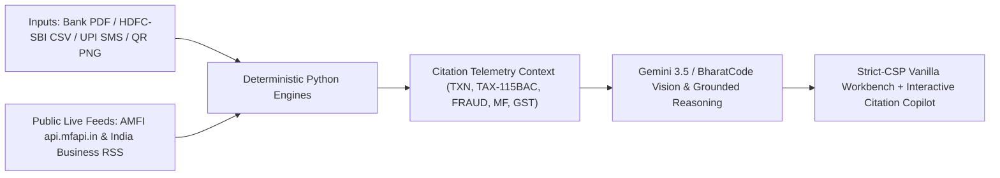

# ArthaLedger

**Evidence-Cited Indian Personal & Small-Business Financial Intelligence Workbench**  
Built for **Arthaton 2026** (`AI for Finance`).

> **Live Production App:** https://arthaledger.vercel.app/  
> **Demo Video (YouTube):** *[Upload under-5-minute working walkthrough to YouTube and paste Public/Unlisted URL here before submitting]*

---

## 1. What Makes ArthaLedger Different

Most AI finance wrappers send numbers to an LLM and hope arithmetic comes back right. **ArthaLedger** separates **verified computation** from **cited explanation & multimodal inspection**:

1. **UPI, Bank SMS, Multi-Bank CSV/TSV & Statement PDF Auto-Scanner (`engines/sms_ledger.py`, `/api/ledger/parse_pdf`):**
   - Imports **Indian Bank Statement `.pdf` files** via Gemini 3.5 multimodal PDF understanding (with offline PDF text-stream fallback), OR auto-detects HDFC/SBI/ICICI/PhonePe CSV/TSV/PSV exports (`Withdrawal Amt.`/`Deposit Amt.`, `Cr/Dr` suffixes, metadata banner auto-skip) and UPI SMS alerts, enforces word-boundary classification across categories and `Subscriptions & Cloud`, supports live search/filter + monthly budget cap utilization bar + quick inline entry, and exports RFC-4180 CSV statements.

2. **Real UPI QR Decoder, APK, Homoglyph & Gemini Vision Forensics (`engines/fraud_shield.py`):**
   - Decodes actual UPI QR code images (`cv2.QRCodeDetector` + Chromium `BarcodeDetector` + serverless-safe pure-Python QR PNG tester) AND extracts payment/SMS screenshots via live Gemini 3.5 Vision (`POST /api/fraud/vision_scan`), feeding into deterministic rules covering `.apk` malware lures (`FRAUD-APK-01`), Unicode zero-width/Cyrillic homoglyphs (`FRAUD-HOMO-01`), 10-digit personal helpline spoofs (`FRAUD-TEL-01`), and `upi://pay?...` Attack Anatomy (`0–100`).

3. **Budget 2025 Tax, Slab Waterfall, Goal Reverse-SIP, LTCG/STCG & Sec 112A Harvesting (`engines/tax_wealth.py`):**
   - Exact **Union Budget 2025 Section 115BAC (FY 2025–26 / FY 2026–27)** progressive slab waterfall table (`#taxSlabTableBody`), Rs.75,000 salaried Standard Deduction, Section 87A rebate up to Rs.12,00,000 taxable income, marginal relief, **Algebraic Deduction Breakeven**, step-up SIP nominal vs. real curve, **Inflation-Adjusted Goal Reverse-SIP Solver**, **Equity MF LTCG (12.5%) / STCG (20%) Calculator**, **Section 112A Rs.1,25,000 Annual Zero-Tax Harvesting Simulator**, and Loan/EMI prepayment amortization.

4. **Live Public AMFI Mutual Funds, Head-to-Head Quant Compare & Real-Time Macro News Impact (`engines/market_backtest.py`):**
   - Queries official public AMFI Indian Mutual Fund schemes via `https://api.mfapi.in`, backtests SMA Crossover and Drawdown Dip Accumulation strategies (non-advisory, zero live trading), runs **AMFI Fund-vs-Fund Head-to-Head Comparison (`POST /api/market/compare`)** with Base-100 normalized curves, Sharpe Ratio, Max Drawdown %, **Pearson Return Correlation (r)** overlap warning, **Direct vs. Regular Plan 1% Trail Commission Leakage**, and **Real-Time India Market & RBI Macro News Sentiment Impact (`POST /api/market/news_impact`)**.

5. **Interactive SME GST Invoice & 90-Day Working Capital Stress (`engines/sme_gst.py`):**
   - Dynamic multi-line invoice builder (`0/5/12/18/28%` slabs), Intra-state (`CGST + SGST`) vs. Inter-state (`IGST`), Input Tax Credit offset, and 90-day Base vs. 35%-Delayed-Receivables cash runway simulation.

6. **Multi-Turn Grounded AI Copilot & Interactive Product Guide (`engines/copilot.py` & `static/`):**
   - Computes a **5-Pillar Financial Health Index (`0–100`)**, supports multi-turn conversation memory with interactive citation badges (`[TXN-04]`, `[TAX-115BAC]`, `[FRAUD-APK-01]`, `[MF-DIRECT-DRAG]`, `[GST-ITC-SET]`) that jump directly to referenced transactions/modules, emits 1-click **"Apply What-If Simulation"** actions, and opens with a clean collapsible SVG analyst welcome guide featuring smooth scroll-parallax depth (`requestAnimationFrame`) and top scroll-progress choreography. Supports **Google Gemini** (`gemini-3.5-flash-lite` / `gemini-3-flash-preview` / `gemini-3.8-flash`), **BharatCode API** (`glm-5.3-flash` vision + text), and an offline deterministic grounded engine.

---

## 2. System Architecture & Arthaton Track Coverage



| Arthaton 2026 Suggested Track | Implemented ArthaLedger Module & Endpoint |
|---|---|
| **Smart Budgeting & Expense Tracking** | Module 01: Bank PDF (`POST /api/ledger/parse_pdf`), Multi-Bank CSV/TSV (`POST /api/ledger/parse_csv`), Subscription leak detector |
| **Financial Scam & Fraud Detection** | Module 02: Pixel QR decoder + Gemini Vision (`POST /api/fraud/vision_scan`), APK/Homoglyph/PIN-trap audit (`POST /api/fraud/audit`) |
| **AI Tax Assistant** | Module 03: Sec 115BAC Budget 2025 slab waterfall (`POST /api/tax/compare`), Goal Reverse-SIP & Sec 112A LTCG Harvesting (`POST /api/wealth/goal`) |
| **AI Investment Guides + Trading & Market Insights (Paper Only)** | Module 04: Live AMFI Backtester (`POST /api/market/backtest`), Fund-vs-Fund Overlap Correlation (`POST /api/market/compare`), Macro News Sentiment (`POST /api/market/news_impact`) |
| **Small Business Finance Automation** | Module 05: Dynamic GST CGST/SGST/IGST Invoice Builder & 90-Day Receivables Stress (`POST /api/sme/gst`) |

---

## 3. AI Models, APIs & Data Sources Used

| Component | Model / Endpoint | Role |
|---|---|---|
| **Google Gemini API** | `gemini-3.5-flash-lite` / `gemini-3-flash-preview` / `gemini-3.8-flash` | Multi-turn grounded synthesis, bank statement PDF parsing & receipt/QR inspection |
| **BharatCode Model API** | `glm-5.3-flash`, `deepseek-chat` | OpenAI-compatible multimodal & text auditing via `https://bharatcode.ai/api/model/v1/chat/completions` |
| **Public Market & News Feeds** | AMFI India (`https://api.mfapi.in`) & Google News India RSS | Real public Mutual Fund NAVs & live RBI/Nifty headline sentiment scoring (zero real-money trades) |
| **Deterministic Grounding** | Built-in `artha-deterministic-citation-v2` | Reproducible offline financial reasoning & 5-pillar Financial Health Index |
| **Runtime & Deployment** | Python 3.12 Standard Library + Vercel WSGI (`api/index.py`) | Zero mandatory external pip dependencies; `script-src 'self'` strict CSP |

---

## 4. Compliance & Security

- **Synthetic / Public Data Only:** All default scenarios use synthetic alerts and `.example` / `@okexample` placeholders. Never place real PAN, bank details, UPI PINs, or broker keys in code.
- **No Real Trades:** Market simulation runs strictly on public AMFI NAVs or synthetic benchmark proxies.
- **Zero Repo Secrets:** API keys can be loaded from gitignored `.env` (`GEMINI_API_KEY` / `BHARATCODE_API_KEY`) or provided per-tab inside browser `sessionStorage`.

---

## 5. How to Run Locally & Test

```bash
git clone https://github.com/mohammedtouffeq-droid/ArthaLedger.git
cd ArthaLedger
python app.py
```

Open **`http://127.0.0.1:8080`** in your browser. Use the top bar to switch personas, toggle Paper/Dark theme, or click **Print Dossier** for an instant PDF/print audit report.

### Run Automated Test Suite

```bash
python -m unittest discover -s tests -v
```
